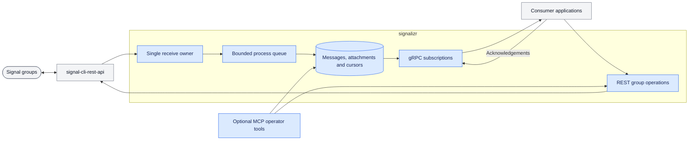

# signalizr

signalizr is a .NET Signal Messenger gateway for applications sharing one Signal account. It
provides named-group REST messaging and durable gRPC inbound subscriptions, with optional MCP
operator tools and a Redis-backed communications responder.

[](https://github.com/f2calv/signalizr/actions/workflows/ci.yml)

Applications use exact Signal group names, not account numbers or group identifiers. The gateway
owns the connection to [signal-cli-rest-api](https://github.com/bbernhard/signal-cli-rest-api);
it is not an arbitrary proxy for that API.

## Quick Start

You need Docker Compose, a Signal account registered or linked in the wrapper, and groups accessible
to that account. Account registration/linking is a separate step: follow the
[wrapper setup guide](https://github.com/bbernhard/signal-cli-rest-api#usage) before sending.

The checked-in Compose example expects groups named `CasCap.Signalizr System` and
`CasCap.Signalizr Demo`. Create those groups or change both indexed
`CasCap__GroupConfig__GroupNames__*` values to your exact group names.

Copy [.env.example](.env.example) to `.env` and set `SIGNALIZR_PHONE_NUMBER` to your linked account.
Keep the real value out of source control.

```bash
cp .env.example .env
```

> [!NOTE]
> `--build` compiles the Release graph, which resolves every shared dependency from NuGet. To use an
> existing published image instead, select an immutable version from
> [container packages](https://github.com/f2calv/signalizr/pkgs/container/signalizr) and use matching
> configuration.

To build and run from source:

```bash
docker compose --profile demo up --build
```

The [Compose definition](docker-compose.yml) starts only the upstream wrapper by default.
The `demo` profile runs a one-shot SQLite migrator before the gateway and waits for gateway
readiness before starting a DemoClient subscriber. To use the alternative PostgreSQL topology:

```bash
docker compose --profile postgres up --build
```

Choose one application profile, never both: only one receiver may own the account. Dependency
endpoints and storage wiring live in the Compose header/definition. Its database credentials are
local-only examples, not deployment credentials.

Stopping Compose preserves volumes. Removing volumes deletes Signal account state and gateway
history; do not use `down --volumes` as routine cleanup.

## Send a Message

After the gateway is ready, send to an exact configured group:

```bash
curl --request POST \
  'http://localhost:8080/api/v1/groups/messages?groupName=CasCap.Signalizr%20Demo' \
  --header 'Content-Type: application/json' \
  --data '{"message":"Deployment finished"}'
```

A successful response is an upstream acknowledgement, not proof that a recipient read the message:

```json
{ "groupName": "CasCap.Signalizr Demo", "timestamp": "1758518400000" }
```

Text is required, limited to 4096 characters. Up to 10 optional `base64Attachments` use upstream
data-URI format, for example `data:image/png;filename=chart.png;base64,...`.

| Operation | Route under `/api/v1/groups` | Success |
| --- | --- | --- |
| List configured names | `GET /` | `200` with an array of names |
| Send text and optional attachments | `POST /messages?groupName={name}` | `200` with group and timestamp |
| Set/remove a reaction | `POST` / `DELETE /reactions?groupName={name}` | `204` |
| React to a retained delivery | `POST` / `DELETE /messages/{deliveryId}/reactions?groupName={name}` | `204` |
| Start/stop typing | `PUT` / `DELETE /typing?groupName={name}` | `204` |
| Create a poll | `POST /polls?groupName={name}` | `200` with group and poll ID |
| Close a poll | `DELETE /polls/{pollId}?groupName={name}` | `204` |

A reaction body contains `reaction`, `targetTimestamp` and optional `targetAuthor`. Omit the author
for messages sent by the gateway. Delivery-based reactions need only `reaction`; they require
Receiver in the same process (`501` otherwise), and retained history (`404` after removal).
A poll body contains `question`, `answers` and optional `allowMultipleSelections`.

Invalid requests return `400`; unknown groups or disabled role routes return `404`; wrapper
HTTP failures return `502`. A failed or timed-out send may already have reached Signal:
do not retry automatically after an uncertain outcome.

## Projects

All projects target .NET 10. The host and core are application components, not NuGet libraries.

| Component | Consumer purpose | Delivery |
| --- | --- | --- |
| [CasCap.App.Server](src/CasCap.App.Server/README.md) | Configure and run the feature-selected host | Container/application |
| [CasCap.Backend](src/CasCap.Backend/README.md) | Understand gateway delivery and persistence behavior | Internal host component |
| [CasCap.Signalizr.Client](src/CasCap.Signalizr.Client/README.md) | Send and subscribe from .NET | [NuGet](https://www.nuget.org/packages/CasCap.Signalizr.Client) |
| [CasCap.Signalizr.Client.Testing](src/CasCap.Signalizr.Client.Testing/README.md) | Test a consumer without a gateway | [NuGet](https://www.nuget.org/packages/CasCap.Signalizr.Client.Testing) |
| [CasCap.Comms](src/CasCap.Comms/README.md) | Redis event delivery, voice processing and reply queue | [NuGet](https://www.nuget.org/packages/CasCap.Comms) |
| [CasCap.Comms.AI](src/CasCap.Comms.AI/README.md) | Optional remote Agent Runtime responder | [NuGet](https://www.nuget.org/packages/CasCap.Comms.AI) |
| [Application chart](charts/signalizr/README.md) | Deploy the wrapper and gateway on Kubernetes | OCI Helm chart |
| [Dashboard chart](charts/signalizr-dashboards/README.md) | Provision Grafana delivery dashboards | Bundled Helm subchart |
| [REST Client requests](requests/README.md) | Call gateway REST and inspect MCP without a model | Editor request collection |
| [Host tests](src/CasCap.App.Server.Tests/README.md), [gateway tests](src/CasCap.Backend.Tests/README.md), [Comms tests](src/CasCap.Comms.Tests/README.md) | Contributor test scope and prerequisites | Source test projects |

All four packages share the repository version. Pin the same immutable version for each one you
use, and pick one that matches your deployed gateway image.

## Service Architecture



## Receiving

Run exactly one Receiver per account, including during deployment rollouts. Its receive loop only
enqueues; a separate dispatcher resolves groups, downloads attachments and persists each delivery.
The bounded process queue drops the oldest message when full. Loss before persistence cannot be
replayed.

After persistence, delivery is at least once within retention. Every subscriber has an independent,
stable `SubscriberName` and durable cursor. New identities start at the current tail; existing
identities resume after their last contiguous acknowledgement. Duplicate live identities are
rejected. Consumers must tolerate redelivery and must not use random or machine-derived names.

Each subscriber receives only the groups listed for its name in `SubscriberConfig:SubscriberGroups`.
A name without an entry is refused, and direct messages are delivered to no subscriber. The cursor
also moves past other groups' messages, so a subscriber whose groups are quiet does not hold back
pruning.

The [.NET client](src/CasCap.Signalizr.Client/README.md#subscribe) acknowledges a message when the
consumer asks for the next one. It does not reconnect automatically. Slow subscribers pause at
`MaxOutstanding` and disconnect after `AckTimeoutMs` without blocking persistence or other clients.

Both inbound `dataMessage` and owner `syncMessage.sentMessage` are handled. `FromSelf` also marks
messages sent by the account owner on another linked device; do not discard them solely on that flag
when your application serves that owner.

Attachments are persisted before delivery. Subscribers receive descriptors and fetch bytes through
`GET /api/v1/attachments/{attachmentId}` until retention removes the parent message.
Messages acknowledged by all subscribers remain for 24 hours by default; a hard 30-day cap removes
even unacknowledged content. These limits bound replay, not an unlimited message archive.

## Configuration

See the [host guide](src/CasCap.App.Server/README.md#configuration) for role selection, required
settings, optional Agent Runtime authentication, ports and storage examples.

Defaults are `Gateway,Receiver`, SQLite, HTTP/1.1 on 8080 and HTTP/2 on 5001. Only Receiver opens
the gRPC listener. The gateway warns about send bursts; it does **not** rate-limit or deduplicate
REST sends. The separate Comms pipeline throttles its own stream-originated traffic.

For Kubernetes, use the [application chart guide](charts/signalizr/README.md), including migration
ordering and persistent storage. The [Grafana guide](charts/signalizr-dashboards/README.md)
explains dashboard provisioning; it does not install Grafana or a metrics collector.

## Authentication and Privacy

REST, attachment downloads, gRPC and health probes have no application authentication. Treat network
access as privileged: consumers can receive all configured groups, and client-side filtering is not
a group authorization boundary. Deliveries can also have a null group name for direct or unmapped
messages. Keep these ports on a trusted network or apply an appropriate
authenticated transport boundary. Compose publishes development ports on the host.

Optional `/mcp` uses HTTP Basic credentials from `CasCap:ApiAuthConfig`, requires `Gateway,Receiver,Mcp`,
and rejects browser `Origin` requests. History disclosure and text sending are separate,
off-by-default switches. Use TLS or a loopback tunnel for Basic credentials. Follow the
[MCP guide](docs/mcp.md) for setup, tool contracts and disclosure risks.

Account numbers, group identifiers, sender fields and conversation content are sensitive. Supply
secrets through untracked local settings, environment variables or a secret store. Do not export
message payloads to logs, metrics or traces. Operator Note-to-Self notices are off by default;
enabling them discloses group/subscriber names to that conversation.

## Observability

`/healthz/startup`, `/healthz/ready` and `/healthz/live` separate startup, dependency readiness and
process health. A wrapper outage affects readiness, not liveness.

The host exports OpenTelemetry through `AppConfig:OtlpExporterEndpoint` when configured.
`AppConfig:MetricNamePrefix` defaults to `signalizr`; `OtelServiceName` controls the resource
service name independently. The host also subscribes to `CasCap.Api.SignalCli` telemetry.
Metrics cover queue drops, persistence, subscriber delivery/acknowledgements, pruning and wrapper
receive/reconnect health; identifiers and message content are not metric labels or trace attributes.

## License

[MIT](LICENSE).
