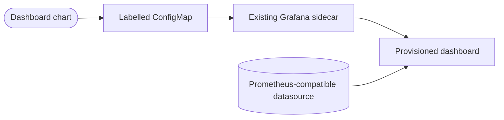

# Signalizr Grafana dashboards

Provides the Signalizr delivery and SignalCli transport Grafana dashboard as a
sidecar-discoverable Kubernetes ConfigMap for operators of an existing monitoring stack.
The [`signalizr`](../signalizr/README.md) application chart bundles it as a `file://` subchart enabled by
`dashboards.enabled`; its version stays fixed at `0.1.0`. Set the values below under the application
chart's `dashboards` key.

## Usage

The chart does not install Grafana, Prometheus or an OpenTelemetry Collector. Your monitoring
pipeline must export the gateway and wrapper metrics to a Prometheus-compatible datasource.
Configure its UID, not its display name:

```yaml
dashboards:
  enabled: true
  dashboardFolder: Signalizr
  datasources:
    prometheus: example-prometheus
```

For a standalone local chart installation:

```bash
helm upgrade --install signalizr-dashboards charts/signalizr-dashboards \
  --namespace example-monitoring --create-namespace \
  --set-string datasources.prometheus=example-prometheus
```

For the bundled chart, ConfigMaps land in the application release namespace. The Grafana sidecar
must watch that namespace (or all intended namespaces) with suitable read permissions.

## Configuration

| Value | Default | Notes |
| --- | --- | --- |
| `enabled` | `true` | Set `false` to render no dashboards |
| `dashboardFolder` | `Signalizr` | Written to the `grafana_folder` annotation |
| `datasources.prometheus` | `prometheus` | Prometheus datasource UID |

Each file under `dashboards/` becomes a ConfigMap named `grafana-dashboard-<file>` with the
`grafana_dashboard: "1"` label, and the datasource UID is substituted into the JSON. Grafana must
run the dashboard sidecar with `folderAnnotation: grafana_folder` for the folder to apply.

## Data Flow



## Dashboards

| File | Title | Scope |
| --- | --- | --- |
| `signalizr-delivery.json` | Signalizr Delivery | Ingress, persistence, subscriber acknowledgements, SignalCli receive health, and inbound and outbound HTTP status codes |

The datasource is substituted by exact string replacement; the dashboard's Grafana legend tokens
remain intact. ConfigMap discovery alone does not prove the selected datasource has the required
metrics.

## Related Projects

- [Grafana dashboard provisioning](https://grafana.com/docs/grafana/latest/administration/provisioning/#dashboards)
- [kube-prometheus-stack](https://github.com/prometheus-community/helm-charts/tree/main/charts/kube-prometheus-stack)
  runs the Grafana sidecar that discovers these ConfigMaps.
- [signalizr](../signalizr/README.md) deploys the gateway these dashboards observe.
