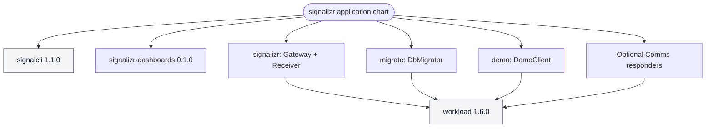

# signalizr

The signalizr Helm application chart deploys a Signal Messenger gateway with its owned
signal-cli REST wrapper. Optional workloads provide a demo subscriber and remote Agent Runtime
responders; a bundled subchart provisions Grafana dashboards.

## Installation

Use Helm 3 with OCI support, a Kubernetes cluster with persistent-volume provisioning, and a
registered or linked Signal account. Account state belongs to the wrapper, while gateway messages
and cursors use separate storage.

The OCI location is `oci://ghcr.io/f2calv/charts/signalizr`. Choose an explicitly published
immutable version from the [chart package](https://github.com/f2calv/signalizr/pkgs/container/charts%2Fsignalizr);
do not install the source `Chart.yaml` placeholder `0.1.0` as though it identifies a published release.
The registry currently contains development-version tags, not a verified stable chart release.
Set the same application image tag on each enabled workload, including the migration Job.

Prepare your account and values first:

1. Register or link the account using the
   [signalcli chart setup](https://github.com/f2calv/helm-charts/tree/main/charts/signalcli#setup).
2. Supply the account number through a Secret or Key Vault; never put it in tracked values.
3. Declare the exact Signal group names. Spaces and case matter; unresolved or ambiguous names fail.
4. Choose SQLite or PostgreSQL and the migration lifecycle below.
5. Keep one Receiver, including during rollout. Do not increase `signalizr.replicaCount`.

For a fresh SQLite installation using receiver startup migrations, save these non-secret overrides
as your values file:

```yaml
signalizr:
  envVars:
    CasCap__GroupConfig__GroupNames__0: Example Chat
  envSecrets:
    CasCap__SignalCliConfig__PhoneNumber: signalizr-account
migrate:
  kind: Deployment
  replicaCount: 0
```

The `signalizr-account` Secret must contain key `CasCap__SignalCliConfig__PhoneNumber`.
Create it through your secret-management process. The example disables the standalone migrator
because the default Job is not a configured SQLite migration barrier.

```bash
helm upgrade --install signalizr oci://ghcr.io/f2calv/charts/signalizr \
  --version <version> --namespace example --create-namespace \
  --values values.local.yaml \
  --set-string signalizr.image.tag=<version> \
  --set-string migrate.image.tag=<version>
```

Use a version whose image provides the selected roles.

## Dependency Graph



The wrapper chart owns the account-state volume and stable `signalcli` Service.
Gateway, migration, demo and responder workloads use the same application image with different
feature flags. The [dashboard guide](../signalizr-dashboards/README.md) explains Grafana discovery.

## Configuration

The authoritative [values file](values.yaml) contains workload settings; use the upstream
[workload reference](https://github.com/f2calv/helm-charts/tree/main/charts/workload) for shared fields.

| Value | Default and purpose |
| --- | --- |
| `signalizr.replicaCount` | `1`; single receive owner |
| `signalizr.strategy` | RollingUpdate with `maxSurge: 0`, `maxUnavailable: 1`; avoids overlap but permits downtime |
| `signalizr.image.tag` | Empty; set an explicit compatible immutable version |
| `signalizr.service` | ClusterIP HTTP port 80 to container 8080 |
| `signalizr.extraPorts` | gRPC port 5001 to container 5001 |
| `signalizr.envVars.CasCap__GroupConfig__GroupNames__*` | None; indexed exact configured names |
| `signalizr.envVars.CasCap__SubscriberConfig__SubscriberGroups__<subscriber>__*` | None; groups each subscriber name receives. Configure an entry for every enabled responder and the demo client |
| `signalizr.envSecrets` | Empty map of environment key to Secret name |
| `signalizr.persistentVolumeClaims` | 1 GiB SQLite claim, mounted at `/var/lib/signalizr`; group ownership 1654 |
| `migrate.kind`, `migrate.replicaCount` | `Job`, `0`; **a Job still renders with zero replicas** |
| `demo.replicaCount` | `0`; set `1` for the length-only inbound demo subscriber |
| `signalizrResponder.replicaCount`, `agentizrResponder.replicaCount` | `0`; enable each only after configuring its Comms dependencies |
| `dashboards.enabled` | `true`; renders dashboard ConfigMaps, not Grafana |
| `signalcli` | Wrapper chart settings; default account-state claim requests 512 MiB |

REST, gRPC and attachment downloads have no built-in authentication. Restrict cluster and ingress
access. MCP is separately opt-in and Basic-authenticated; see the [MCP guide](../../docs/mcp.md).
Plaintext gRPC must use the dedicated HTTP/2 listener, not the HTTP/1.1 Service port.

## Persistence and Migration

The default application uses SQLite on its own PVC and migrates on startup. The checked-in
`migrate` Job has neither a shared SQLite volume nor sequencing annotations; it must be disabled
as in the fresh-install example, or configured explicitly. Setting `replicaCount: 0` alone does not
disable a workload whose `kind` is `Job`.

For an independently managed SQLite migrator, mount the same claim into the Job, give it writable
permissions, stop the receiver while migrating, and start the receiver only after successful
completion with `MigrateOnStartup=false`. Preserve existing claims when changing lifecycle settings.

For PostgreSQL, provision the database separately. Merge the following with your account/group and
image settings. It uses Argo CD PreSync ordering; plain Helm does not interpret Argo CD hooks.
Outside Argo CD, run and verify the migration before starting the receiver.

```yaml
signalizr:
  envVars:
    CasCap__DatabaseConfig__Provider: Postgres
    CasCap__DatabaseConfig__MigrateOnStartup: "false"
  envSecrets:
    CasCap__SignalCliConfig__PhoneNumber: signalizr-account
    CasCap__DatabaseConfig__ConnectionString: signalizr-postgres
  persistentVolumeClaims: []
  volumes: []
  volumeMounts: []
migrate:
  kind: Job
  envVars:
    CasCap__DatabaseConfig__Provider: Postgres
  envSecrets:
    CasCap__DatabaseConfig__ConnectionString: signalizr-postgres
  job:
    annotations:
      argocd.argoproj.io/hook: PreSync
      argocd.argoproj.io/hook-delete-policy: BeforeHookCreation
```

The `signalizr-postgres` Secret must contain `CasCap__DatabaseConfig__ConnectionString`.
Optional `CasCap__DatabaseConfig__DatabaseName` must match between migrator and receiver.
Removing SQLite mounts is appropriate for a fresh PostgreSQL deployment; it does not migrate
existing data. Back up and preserve existing PVCs before changing a deployed storage configuration.

Gateway retention defaults to 24 hours after all subscribers acknowledge and a hard 30-day cap for
all content. Account state on the wrapper's volume has a separate lifecycle.

## Optional Responders

Each responder runs `Comms` alone, uses `Recreate`, has no Service and must remain single-instance
for its configured durable subscriber name. Configure its exact `CommsConfig:GroupName`, Redis,
Agent Runtime address and execution identity. Default stream consumption is off, but inbound
deduplication still needs Redis. Set an explicit image tag on every enabled responder.

Supply credentials as `CasCap__AgentRuntimeAzureAuthConfig__*` Secret values, or use
`AppConfig__KeyVaultName`, `AppConfig__AgentRuntimeKeyVaultPrefix` and an
`AppConfig__AzureEntra*` credential. See the
[host responder guide](../../src/CasCap.App.Server/README.md#comms-responder) for the boundary between
gateway credentials, runtime authentication and application session configuration.
