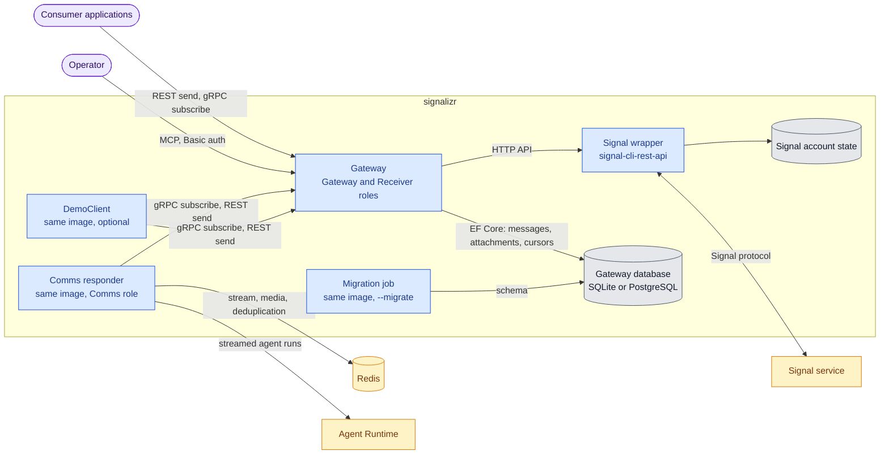
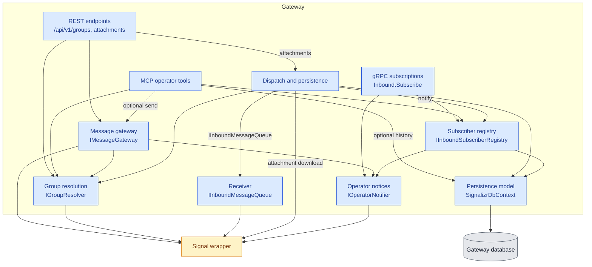
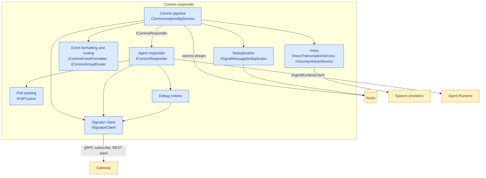
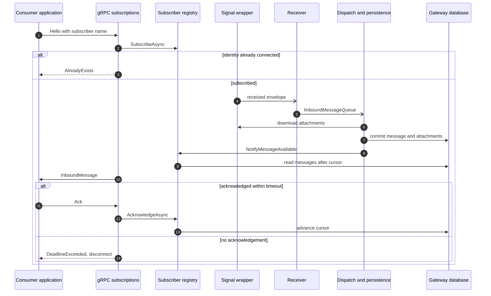

# Architecture

This drilldown opens signalizr from the [System Context](../README.md#system-context) into its
containers and the components of its two application roles. Project READMEs keep their focused
flows: the [Backend delivery data flow](../src/CasCap.Backend/README.md), the
[Comms event flow](../src/CasCap.Comms/README.md) and the
[Comms.AI responder sequence](../src/CasCap.Comms.AI/README.md).

## Containers

One release image provides every signalizr process; `CasCap:FeatureConfig:EnabledFeatures` selects
its role. The gateway runs `Gateway` and `Receiver` together and is the single owner of the Signal
account. A Comms responder is the same image running only `Comms`: a client of the gateway like any
other application. The [chart](../charts/signalizr/README.md) deploys the wrapper, the gateway and a
migration Job, with dormant DemoClient and Comms responder workloads.

PostgreSQL and Redis are supplied by the deployment; the Compose file starts local instances.

## Gateway Components

The gateway separates the single receive loop from everything that may block: the Receiver only
enqueues, and the dispatcher resolves groups, downloads attachments and persists each delivery
before notifying subscribers. Every call to Signal goes through the wrapper's HTTP API.

## Gateway Code Map

Gateway components span three projects: endpoints in `CasCap.App.Server`, behavior in
`CasCap.Backend` and the EF Core model in `CasCap.Data`.

| Component | Responsibility | Code location | Provides | Requires |
| --- | --- | --- | --- | --- |
| REST endpoints | Named-group send, reactions, typing, polls and attachment download | `CasCap.App.Server/Controllers/`, `Services/GroupsApiExceptionHandler.cs` | `/api/v1/groups`, attachment route | `IMessageGateway`, `IGroupResolver`, `InboundAttachmentService` |
| gRPC subscriptions | Bidirectional delivery stream with acknowledgements and timeouts | `CasCap.App.Server/Services/InboundGrpcService.cs`, `CasCap.Signalizr.Client/Protos/inbound.proto` | `Inbound.Subscribe` | `IInboundSubscriberRegistry`, `IOperatorNotifier` |
| MCP operator tools | Status, group list, optional history and optional send | `CasCap.App.Server/Services/SignalizrMcp*.cs`, `Extensions/McpServiceExtensions.cs` | `/mcp` tools and prompts | `IGroupResolver`, `IInboundSubscriberRegistry`, `IMessageGateway`, `SignalizrDbContext` |
| Message gateway | Sends messages, reactions, typing leases and polls to exact group names | `CasCap.Backend/Services/MessageGateway.cs`, `TypingLeaseService.cs` | `IMessageGateway` | `IGroupResolver`, `IOperatorNotifier`, wrapper |
| Group resolution | Maps configured group names to wrapper group identifiers, retrying while the wrapper is down | `CasCap.Backend/Services/GroupResolver.cs`, `GatewayBgService.cs` | `IGroupResolver` | Wrapper |
| Receiver | Single owner of the wrapper receive stream; only enqueues into a drop-oldest queue | `CasCap.Backend/Services/ReceiverBgService.cs`, `InboundMessageQueue.cs` | `IInboundMessageQueue` | Wrapper |
| Dispatch and persistence | Maps envelopes to deliveries, stores attachments and messages, prunes retention | `CasCap.Backend/Services/DispatcherBgService.cs`, `InboundMessagePersistenceService.cs`, `InboundAttachmentService.cs`, `DurableMessagePrunerService.cs` | `InboundAttachmentService` | `IInboundMessageQueue`, `IGroupResolver`, `IInboundSubscriberRegistry`, `SignalizrDbContext`, wrapper |
| Subscriber registry | One live stream per subscriber identity, durable cursors and per-group fan-out | `CasCap.Backend/Services/InboundSubscriberRegistry.cs`, `InboundSubscription.cs` | `IInboundSubscriberRegistry` | `SignalizrDbContext`, `IOperatorNotifier` |
| Operator notices | Bounded queue of operational notices sent to the operator group | `CasCap.Backend/Services/OperatorNotifier.cs` | `IOperatorNotifier` | Wrapper |
| Persistence model | Entities, context and migrations for messages, attachments and cursors | `CasCap.Data/`, `CasCap.Backend/Extensions/DataServiceCollectionExtensions.cs` | `SignalizrDbContext` | SQLite or PostgreSQL |

## Comms Responder Components

The Comms responder is assembled from the published `CasCap.Comms` and `CasCap.Comms.AI` packages,
which other hosts also consume. Event producers in other applications write to the Redis stream through
the package's stream sink; the responder only reads it.

## Comms Responder Code Map

| Component | Responsibility | Code location | Provides | Requires |
| --- | --- | --- | --- | --- |
| Comms pipeline | Reads the event stream and gateway deliveries, filters, throttles and drains a bounded reply queue | `CasCap.Comms/Services/CommunicationsBgService*.cs` | `Comms` background feature | All components below, Redis |
| Deduplication | Suppresses duplicate deliveries by hashed message identity | `CasCap.Comms/Services/RedisSignalMessageDeduplicator.cs` | `ISignalMessageDeduplicator` | Redis |
| Event formatting and routing | Formats stream events and routes monitor sources to the monitor group | `CasCap.Comms/Services/*CommsEventFormatter.cs`, `MonitorSourcesGroupRouter.cs` | `ICommsEventFormatter`, `ICommsGroupRouter` | None |
| Voice | Transcribes voice notes and synthesizes spoken replies | `CasCap.Api.Voice` package | `IVoiceTranscriptionService`, `IVoiceSynthesisService` | Speech providers |
| Agent responder | Runs streamed Agent Runtime turns and slash commands, producing replies | `CasCap.Comms.AI/Services/AgentCommsResponder*.cs`, `Extensions/CommsAgentCommandParser.cs` | `ICommsResponder` | `IAgentRuntimeClient`, `ISignalizrClient`, `IPollTracker`, Debug notices |
| Poll tracking | Remembers active polls so votes can become responder turns | `CasCap.Comms.AI/Services/InMemoryPollTracker.cs` | `IPollTracker` | None |
| Debug notices | Posts run statistics and diagnostics to the monitor group when enabled | `CasCap.Comms.AI/Services/CommsDebugNotifier.cs` | Debug footer and notices | `ISignalizrClient` |
| Signalizr client | Typed REST and gRPC client for the gateway | `CasCap.Signalizr.Client/` | `ISignalizrClient` | Gateway |

## Runtime Scenarios

### Receive and Deliver a Message

Delivery is at least once after persistence. A subscriber that stops acknowledging is disconnected;
on reconnection it resumes after its last contiguous acknowledgement.

