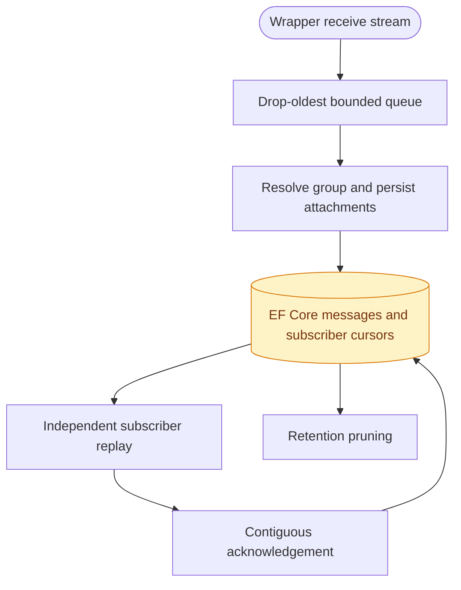

# CasCap.Backend

The .NET 10 gateway core used by the signalizr application host. It resolves named groups, owns
inbound persistence and subscriber cursors, and implements Signal sends and group interactions.
It is not a published NuGet package or a standalone service.

Its assembly identity is `CasCap.Signalizr`; existing namespaces, telemetry service names and
consumer-client package identities are independent of the backend project name.

## Usage

Operators run [CasCap.App.Server](../CasCap.App.Server/README.md), which registers the selected
features and transports. Consumer applications should use
[CasCap.Signalizr.Client](../CasCap.Signalizr.Client/README.md), not host implementation types.

[`IMessageGateway`](Abstractions/IMessageGateway.cs) exposes sends, reactions, typing and polls against exact configured group names.
[`IGroupResolver`](Abstractions/IGroupResolver.cs) hides account-linked identifiers and rejects unresolved, duplicate and ambiguous
names. The gateway owns account profile policy; consumers cannot change the shared profile.

## Data Flow

Exactly one Receiver reads the account. Its loop only enqueues; database work and outbound calls do
not run in that loop. Queue overflow drops the oldest item and is counted. Nothing lost before
persistence is replayable.

After persistence, stable subscriber identities have independent durable cursors and at-least-once
delivery within retention. New subscribers start at the current tail; reconnecting subscribers
resume after their last contiguous acknowledgement. An identity can own only one live stream.
Outstanding-message bounds and acknowledgement timeouts isolate stalled subscribers.
Each delivery's acknowledgement budget starts when its slot is reserved, before writing the
response, and expires even if it is the last message. Acknowledging the head does not reset the age
of the next outstanding delivery. Invalid or late acknowledgements do not advance the cursor.
An idle stream with no outstanding deliveries remains connected.

Attachments are stored with the inbound message, exposed as descriptors and downloaded through
the host's REST attachment endpoint. Retention cascades to attachment bytes. Both `dataMessage`
and `syncMessage.sentMessage` are supported; `FromSelf` is not a sufficient filter for an
application serving the account owner.

## Configuration

The [host configuration reference](../CasCap.App.Server/README.md#configuration) and
[configuration examples](../CasCap.App.Server/README.md#configuration-examples) describe the
public settings. Core options bind under `CasCap`:

- `GroupConfig`, `GatewayConfig` and `OperatorNotificationConfig` govern names and account policy.
- `ReceiverConfig` bounds the process queue and attachment size.
- `SubscriberConfig` bounds replay batches, outstanding messages and acknowledgement time.
- `DatabaseConfig` selects SQLite/PostgreSQL and migration/retention policy.

SQLite and PostgreSQL use EF Core migrations. InMemory is non-durable and requires an explicit
test override; the standalone migrator rejects it. The 24-hour acknowledged-retention default
does not override the hard 30-day message-content cap.

REST send flood detection warns but neither queues nor rejects sends. Typing uses process-local
refreshing leases with a maximum duration. Operator notices are disabled by default and, when
enabled, go to the account's Note-to-Self conversation.

## Development

Debug builds use adjacent shared-library sources; Release uses the package references declared in
the project. Run/build through the host only after its dependency prerequisites are met.
The [gateway test guide](../CasCap.Backend.Tests/README.md) describes offline queue, cursor,
retention, REST, gRPC and MCP coverage.
