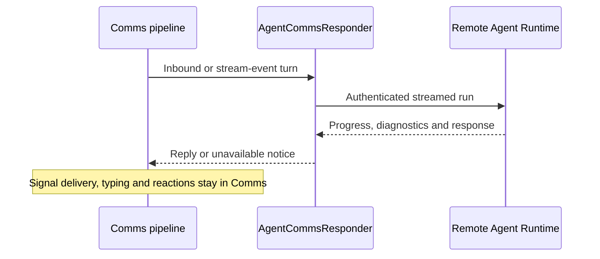

# CasCap.Comms.AI

The .NET 10 AI responder for the
[CasCap.Comms pipeline](https://github.com/f2calv/signalizr/blob/main/src/CasCap.Comms/README.md).
It connects Signal messages to a separately operated Agent Runtime; it does not host models or own
runtime definitions, credentials or session storage.

## Installation and Usage

```bash
dotnet add package CasCap.Comms.AI
```

The package depends on `CasCap.Comms` and the Agent Runtime client and contracts. Debug builds of this
repository use adjacent Agent Runtime source projects instead.

After configuring the base Comms host and its Redis/gateway dependencies:

```csharp
using Microsoft.Extensions.DependencyInjection;

services.AddComms(configuration);
var runtimeHttpClient = services.AddCommsAgent();
```

The returned `IHttpClientBuilder` is the seam for your authentication and resilience handlers.
Registration does not supply runtime credentials or start the Comms [`IBgFeature`](https://github.com/f2calv/CasCap.Common/blob/main/src/CasCap.Common.Abstractions/Abstractions/IBgFeature.cs); your host owns
both. The bundled application wires workload authentication in its
[Comms role](https://github.com/f2calv/signalizr/blob/main/src/CasCap.App.Server/README.md#comms-responder).

## Purpose

`AgentCommsResponder` implements `ICommsResponder` through `CasCap.AgentRuntime.Client`. It:

- turns chat-bound stream events and inbound messages into agent turns, with conversation sessions,
  model and instruction overrides and optional session bypass;
- owns slash-command syntax while the runtime owns session/override mutations, and handles poll votes through `IPollTracker`;
- never forwards text starting with `/` to the model: an unrecognised command, including an unknown
  subcommand such as `/session help`, answers with the `/help` list. Command replies longer than one
  chat message are split into numbered parts such as `(1/3)`;
- shows the effective instructions for `/instructions` (the session override, else the active
  definition) when the runtime tenant enables `InstructionsDisclosureEnabled`, and otherwise only
  the session's own override; `/instructions reset` clears the override;
- reports sub-agent delegation with a reaction swap and, optionally, a status message;
- appends a stats footer to each reply and posts a pipeline timeline, stream-event notices and
  compaction notices to the monitor group through `CommsDebugNotifier`;
- answers a failed runtime call with a short notice such as `Assistant unavailable: the agent
  runtime returned HTTP 503.`, which is sent but never spoken and marks the message with ❌. An empty
  answer is treated as the agent choosing to stay quiet and sends nothing;
- names every tool that failed, including inside delegated agents, on a `⚠️ Tool failed:` footer
  line, because the model's answer may not mention it, and marks failed calls with ❌ in the
  monitor timeline;
- counts every run in `{prefix}.comms.agent.runs`, tagged with a bounded `outcome`
  (`Succeeded`, `CompletedWithToolErrors`, `EmptyOutput`, `NoResponse`, `Unreachable`, `HttpError`,
  `Timeout`, `Error`).

The runtime owns tenant definitions, credentials, agent construction, tools and version-qualified
session state. Comms retains Signal delivery, typing, reactions, polls, attachments and diagnostics.

## Tool Approval

High-impact MCP tools, such as unlocking a door, can require a person in the chat group to approve
each call. Mark the tool method with `[RequiresApproval]` and add the filter to the MCP server that
exposes it:

```csharp
using CasCap.Attributes;
using Microsoft.Extensions.DependencyInjection;

[McpServerTool(ReadOnly = false, Destructive = true)]
[RequiresApproval]
[Description("Opens the gate. A person in the household chat must approve each call.")]
public Task<bool> OpenGate() => gateSvc.OpenAsync();

services.AddMcpServer()
    .WithHttpTransport()
    .WithTools<GateMcpQueryService>()
    .WithToolApproval();
```

A gated call posts an Approve/Deny poll naming the tool, its arguments and the requesting agent,
then waits up to `ToolApprovalConfig.TimeoutMs`. `ToolApprovalService` claims votes on that poll
through `IPollVoteHandler` before the responder sees them, so a model can neither read nor answer
its own approval request. Only an accepted Approve runs the tool. A Deny, timeout, unreachable
gateway, cancelled caller or restart returns a refusal the model can relay, not an error.

The filter fails closed. `AddCommsAgent()` registers `ToolApprovalService`; an MCP host without it
refuses gated tools rather than running them. The requesting agent is read from the
`agentizr/agent-name` call `_meta` key sent by the Agent Runtime, falling back to the MCP client
name. It is informational only and never authorizes anything.

Pending approvals are process-local, which suits the single-replica Comms deployment.

## Public Surface

| Type | Purpose |
| --- | --- |
| `AgentCommsResponder` | [`ICommsResponder`](https://github.com/f2calv/signalizr/blob/b5ae4f04ff8a6f9f9f611da60a08872a41e34176/src/CasCap.Comms/Abstractions/ICommsResponder.cs) backed by the streamed Agent Runtime client |
| `CommsDebugNotifier` | Stats footer and monitor-group diagnostics |
| `CommsAgentMetrics` | Run counter by `CommsAgentRunOutcome` |
| [`IAgentRunEnricher`](https://github.com/f2calv/signalizr/blob/b5ae4f04ff8a6f9f9f611da60a08872a41e34176/src/CasCap.Comms.AI/Abstractions/IAgentRunEnricher.cs) | Host seam for measurements around each run, such as GPU energy use; `RequiresDiagnosticDetails` opts in to tool arguments and runtime property bags |
| `CommsAgentProfile` | Runtime agent name, opaque session identifier and attachment fallback prompt |
| `CommsDebugStep` | One step of the monitor-group pipeline timeline |
| `MessagingMcpQueryService` | MCP poll tools (`create_poll`, `close_poll`, `get_poll_status`) on the chat group |
| [`IPollTracker`](https://github.com/f2calv/signalizr/blob/b5ae4f04ff8a6f9f9f611da60a08872a41e34176/src/CasCap.Comms.AI/Abstractions/IPollTracker.cs), `InMemoryPollTracker` | Comms-owned poll lifecycle, votes, result summaries, and TTL expiry; process-local, so a restart forgets open polls |
| `RequiresApprovalAttribute` | Marks an MCP tool method that needs approval before it runs |
| `ToolApprovalService` | Posts approval polls and decides them from accepted votes |
| `ToolApprovalOutcome` | `Approved`, `Denied`, `TimedOut` or `Unavailable` |
| `CommsAgentServiceCollectionExtensions` | `AddCommsAgent()`, `AddMessagingMcp()` and `AddToolApproval()` |
| `ToolApprovalMcpServerBuilderExtensions` | `WithToolApproval()` call-tool filter for an MCP server |

## Configuration

The responder reads `CommsConfig` from the
[Comms configuration guide](https://github.com/f2calv/signalizr/blob/main/src/CasCap.Comms/README.md#configuration).
Configure the
runtime address and timeout under `CasCap:AgentRuntimeClientOptions`; the host attaches workload
authentication and resilience to the `IHttpClientBuilder` returned by `AddCommsAgent`.

`CommsConfig.PollTtlMs` controls how long an agent-created poll remains available for votes
(default one hour). Poll state is process-local and lost on restart.

The run counter uses `CasCap:CommsMetricsConfig:MetricNamePrefix` (default `comms`). Set it to the
host's exported meter prefix so its OpenTelemetry pipeline collects the counter.

## Configuration Examples

Minimal responder-specific settings; merge with the gateway, Redis and subscriber configuration in
the Comms guide:

```json
{
  "CasCap": {
    "CommsConfig": {
      "AgentName": "CommsAgent",
      "AgentSessionId": "example-session"
    },
    "AgentRuntimeClientOptions": {
      "BaseAddress": "http://localhost:5090",
      "TimeoutMinutes": 10
    }
  }
}
```

Optional reply/diagnostic behavior:

```json
{
  "CasCap": {
    "CommsConfig": {
      "AgentDefaultPrompt": "Describe this attachment.",
      "PollTtlMs": 3600000,
      "DelegationMessagesEnabled": false,
      "FooterTokenCountsEnabled": true,
      "MonitorContentEnabled": false
    }
  }
}
```

Use an opaque stable `AgentSessionId`, not a Signal group name or personal identifier.
Runtime name, session and fallback prompt default to `CommsAgent`, `primary-group` and
`Describe this attachment.`. Register `IAgentRunEnricher` implementations only when needed;
`RequiresDiagnosticDetails` opts into potentially sensitive tool arguments and property bags.

Tool approval works with its defaults: enabled, a 30-second timeout and any chat-group member as
approver. Restrict approvers or override gating per exposed tool name:

```json
{
  "CasCap": {
    "ToolApprovalConfig": {
      "TimeoutMs": 30000,
      "ApproverIds": ["00000000-0000-0000-0000-000000000000"],
      "RequiredTools": ["open_garage"],
      "WaivedTools": []
    }
  }
}
```

`ApproverIds` are the voter identifiers Signal delivers. They are personal data, so keep them in
private configuration. Votes from anyone else are ignored rather than treated as a denial.
`ApprovalEnabled: false` runs gated tools immediately; use it only for local development.

## Runtime Scenarios

### Responder Turn



## Dependencies

| Dependency | Use |
| --- | --- |
| `CasCap.Comms` | The pipeline this responder answers for |
| `CasCap.AgentRuntime.Client` | Streamed turns and typed session/override operations |
| `CasCap.AgentRuntime.Contracts` | Stable run, diagnostic and control DTOs |
| `ModelContextProtocol` | Poll tool attributes and the tool-approval call filter |

The poll MCP service registration supplies tools, not a listening MCP server. A host must expose
them deliberately; it is separate from the gateway's optional operator `/mcp` surface.
