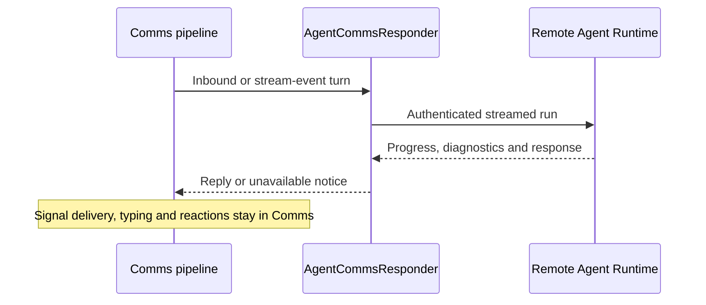

# CasCap.Comms.AI

The .NET 10 AI responder for the
[CasCap.Comms pipeline](https://github.com/f2calv/signalizr/blob/main/src/CasCap.Comms/README.md).
It connects Signal messages to a separately operated Agent Runtime; it does not host models or own
runtime definitions, credentials or session storage.

## Installation and Usage

This is a packable source project; no public `CasCap.Comms.AI` NuGet version is currently verified.
Debug builds require the adjacent Agent Runtime client and contracts source projects declared in the
project. The current project has no Release references for those dependencies, so a standalone
Release build is not yet a supported installation path.

After configuring the base Comms host and its Redis/gateway dependencies:

```csharp
using Microsoft.Extensions.DependencyInjection;

services.AddComms(configuration);
var runtimeHttpClient = services.AddCommsAgent();
```

The returned `IHttpClientBuilder` is the seam for your authentication and resilience handlers.
Registration does not supply runtime credentials or start the Comms `IBgFeature`; your host owns
both. The bundled application wires workload authentication in its
[Comms role](https://github.com/f2calv/signalizr/blob/main/src/CasCap.App.Server/README.md#comms-responder).

## Purpose

`AgentCommsResponder` implements `ICommsResponder` through `CasCap.AgentRuntime.Client`. It:

- turns chat-bound stream events and inbound messages into agent turns, with conversation sessions,
  model and instruction overrides and optional session bypass;
- owns slash-command syntax while the runtime owns session/override mutations, and handles poll votes through `IPollTracker`;
- never forwards text starting with `/` to the model: an unrecognised command, including an unknown
  subcommand such as `/session help`, answers with the `/help` list. Command replies longer than one
  chat message are split into numbered parts such as `(1/3)`;
- shows the effective instructions for `/instructions` (the session override, else the active
  definition) when the runtime tenant enables `InstructionsDisclosureEnabled`, and otherwise only
  the session's own override; `/instructions reset` clears the override;
- reports sub-agent delegation with a reaction swap and, optionally, a status message;
- appends a stats footer to each reply and posts a pipeline timeline, stream-event notices and
  compaction notices to the monitor group through `CommsDebugNotifier`;
- answers a failed runtime call with a short notice such as `Assistant unavailable: the agent
  runtime returned HTTP 503.`, which is sent but never spoken and marks the message with ❌. An empty
  answer is treated as the agent choosing to stay quiet and sends nothing;
- names every tool that failed, including inside delegated agents, on a `⚠️ Tool failed:` footer
  line, because the model's answer may not mention it, and marks failed calls with ❌ in the
  monitor timeline;
- counts every run in `{prefix}.comms.agent.runs`, tagged with a bounded `outcome`
  (`Succeeded`, `CompletedWithToolErrors`, `EmptyOutput`, `NoResponse`, `Unreachable`, `HttpError`,
  `Timeout`, `Error`).

The runtime owns tenant definitions, credentials, agent construction, tools and version-qualified
session state. Comms retains Signal delivery, typing, reactions, polls, attachments and diagnostics.

## Public Surface

| Type | Purpose |
| --- | --- |
| `AgentCommsResponder` | `ICommsResponder` backed by the streamed Agent Runtime client |
| `CommsDebugNotifier` | Stats footer and monitor-group diagnostics |
| `CommsAgentMetrics` | Run counter by `CommsAgentRunOutcome` |
| `IAgentRunEnricher` | Host seam for measurements around each run, such as GPU energy use; `RequiresDiagnosticDetails` opts in to tool arguments and runtime property bags |
| `CommsAgentProfile` | Runtime agent name, opaque session identifier and attachment fallback prompt |
| `CommsDebugStep` | One step of the monitor-group pipeline timeline |
| `MessagingMcpQueryService` | MCP poll tools (`create_poll`, `close_poll`, `get_poll_status`) on the chat group |
| `IPollTracker`, `InMemoryPollTracker` | Comms-owned poll lifecycle, votes, result summaries, and TTL expiry; process-local, so a restart forgets open polls |
| `CommsAgentServiceCollectionExtensions` | `AddCommsAgent()` and `AddMessagingMcp()` |

## Configuration

The responder reads `CommsConfig` from the
[Comms configuration guide](https://github.com/f2calv/signalizr/blob/main/src/CasCap.Comms/README.md#configuration).
Configure the
runtime address and timeout under `CasCap:AgentRuntimeClientOptions`; the host attaches workload
authentication and resilience to the `IHttpClientBuilder` returned by `AddCommsAgent`.

`CommsConfig.PollTtlMs` controls how long an agent-created poll remains available for votes
(default one hour). Poll state is process-local and lost on restart.

The run counter uses `CasCap:CommsMetricsConfig:MetricNamePrefix` (default `comms`). Set it to the
host's exported meter prefix so its OpenTelemetry pipeline collects the counter.

## Configuration Examples

Minimal responder-specific settings; merge with the gateway, Redis and subscriber configuration in
the Comms guide:

```json
{
  "CasCap": {
    "CommsConfig": {
      "AgentName": "CommsAgent",
      "AgentSessionId": "example-session"
    },
    "AgentRuntimeClientOptions": {
      "BaseAddress": "http://localhost:5090",
      "TimeoutMinutes": 10
    }
  }
}
```

Optional reply/diagnostic behavior:

```json
{
  "CasCap": {
    "CommsConfig": {
      "AgentDefaultPrompt": "Describe this attachment.",
      "PollTtlMs": 3600000,
      "DelegationMessagesEnabled": false,
      "FooterTokenCountsEnabled": true,
      "MonitorContentEnabled": false
    }
  }
}
```

Use an opaque stable `AgentSessionId`, not a Signal group name or personal identifier.
Runtime name, session and fallback prompt default to `CommsAgent`, `primary-group` and
`Describe this attachment.`. Register `IAgentRunEnricher` implementations only when needed;
`RequiresDiagnosticDetails` opts into potentially sensitive tool arguments and property bags.

## Service Architecture



## Dependencies

| Dependency | Use |
| --- | --- |
| `CasCap.Comms` | The pipeline this responder answers for |
| `CasCap.AgentRuntime.Client` | Streamed turns and typed session/override operations |
| `CasCap.AgentRuntime.Contracts` | Stable run, diagnostic and control DTOs |
| `ModelContextProtocol` | Poll tool attributes |

The poll MCP service registration supplies tools, not a listening MCP server. A host must expose
them deliberately; it is separate from the gateway's optional operator `/mcp` surface.
