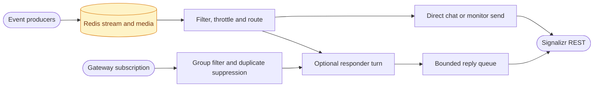

# CasCap.Comms

The Signalizr communications pipeline shared by applications that talk to Signal Messenger through
a [signalizr](https://github.com/f2calv/signalizr) gateway. It combines Redis event delivery,
inbound messages, optional voice processing and a bounded reply queue for .NET 10 hosts.

## Installation and Host Setup

```bash
dotnet add package CasCap.Comms
```

Register the pipeline in a host that already supplies configuration, logging and `TimeProvider`:

```csharp
using Microsoft.Extensions.DependencyInjection;

services.AddCasCapCaching(configuration);
services.AddComms(configuration);
```

`AddComms` registers an [`IBgFeature`](https://github.com/f2calv/CasCap.Common/blob/main/src/CasCap.Common.Abstractions/Abstractions/IBgFeature.cs), not an independently started hosted service. Your host must
run that feature through its feature dispatcher. The
[signalizr host](https://github.com/f2calv/signalizr/blob/main/src/CasCap.App.Server/README.md#comms-responder)
is a concrete integration, with an additional AI responder; it is not the library's default behavior.
`AddComms(configuration, lite: true)` registers dependencies without the background feature.

Redis is required for stream/media storage and inbound duplicate suppression. An existing gateway
must serve your configured groups. Voice modes remain disabled until you configure their providers.

For producer-only processes, register `AddCommsStreamSink()` instead of starting a consumer. Resolve
[`IEventSink<CommsEvent>`](https://github.com/f2calv/CasCap.Common/blob/main/src/CasCap.Common.Abstractions/Abstractions/IEventSink%7BT%7D.cs) and write a notification:

```csharp
using CasCap.Common.Abstractions;

await sink.WriteEvent(new CommsEvent
{
    Source = "ExampleJob",
    Message = "Scheduled task completed",
    Environment = "Development",
    TimestampUtc = DateTime.UtcNow
}, cancellationToken);
```

The producer must also register caching, a clock and its host environment. `AddTrackedOperations()`
adds the stream sink and a hosted progress/timeout reporter for `ITrackedOperationService`.

## Purpose

`CommunicationsBgService` is the single component of an application that talks to Signal. It:

- consumes `CommsEvent` entries that any pod writes to a Redis Stream, applying flood protection
  (a token-bucket rate limit and a stale-event cut-off, both announced by a drop notice);
- routes each event to the chat group or an operator-only monitor group, attaching media cached in
  Redis;
- subscribes to inbound group messages, suppresses redeliveries, acknowledges them with reactions,
  and transcribes voice notes;
- answers through an optional `ICommsResponder` via a bounded reply queue, with typing indicators and
  optional spoken replies.

Without an available responder, chat-bound events are formatted and sent directly and inbound
messages are only logged. With `StreamEventTurnsEnabled` set to `false`, chat-bound events are sent
directly even when a responder answers inbound messages; `DirectDeliverySources` does the same for
selected event sources only. [CasCap.Comms.AI](https://github.com/f2calv/signalizr/blob/main/src/CasCap.Comms.AI/README.md)
provides the AI agent responder.

## Event Flow



## Public Surface

| Type | Purpose |
| --- | --- |
| `CommunicationsBgService` | The `Comms` background feature |
| `CommsStreamSinkService` | `IEventSink<CommsEvent>` that writes to the comms stream (`[SinkType("CommsStream")]`) |
| `CommsMediaStore` | Caches attachment bytes in Redis and returns the `MediaReference` a producer puts in `JsonPayload` |
| [`ITrackedOperationService`](https://github.com/f2calv/signalizr/blob/b5ae4f04ff8a6f9f9f611da60a08872a41e34176/src/CasCap.Comms/Abstractions/ITrackedOperationService.cs), `TrackedOperationService` | Stream-based progress, completion and timeout notifications |
| [`ICommsResponder`](https://github.com/f2calv/signalizr/blob/b5ae4f04ff8a6f9f9f611da60a08872a41e34176/src/CasCap.Comms/Abstractions/ICommsResponder.cs) | Seam that produces replies: stream-event turns, poll votes, commands and queued turns |
| `IPollVoteHandler` | Claims poll votes decided by code, such as approval answers, before the responder sees them |
| `CommsTurn`, `CommsReply`, `CommsCommandOutcome` | The units of work and results exchanged with a responder |
| `PlainCommsEventFormatter` | Default [`ICommsEventFormatter`](https://github.com/f2calv/CasCap.Common/blob/main/src/CasCap.Common.Abstractions/Abstractions/ICommsEventFormatter.cs): the event message unchanged |
| `TimestampedCommsEventFormatter` | `ICommsEventFormatter` producing `HH:mm:ss.fff UTC [environment] [source] message` |
| `MonitorSourcesGroupRouter` | Default [`ICommsGroupRouter`](https://github.com/f2calv/CasCap.Common/blob/main/src/CasCap.Common.Abstractions/Abstractions/ICommsGroupRouter.cs): `CommsConfig.MonitorSources` go to the monitor group |
| [`ISignalMessageDeduplicator`](https://github.com/f2calv/signalizr/blob/b5ae4f04ff8a6f9f9f611da60a08872a41e34176/src/CasCap.Comms/Abstractions/ISignalMessageDeduplicator.cs), `RedisSignalMessageDeduplicator` | Duplicate suppression by hashed message identity |
| `CommsServiceCollectionExtensions` | `AddCommsStreamSink()` for producers and `AddComms(configuration)` for the `Comms` feature |

`ICommsEventFormatter`, `ICommsGroupRouter`, `CommsEvent` and `MediaReference` live in
`CasCap.Common.Abstractions`. Register a formatter, router or deduplicator before `AddComms` to replace
the default.

## Configuration

`CommsConfig` binds from `CasCap:CommsConfig`. Group names must match the gateway's configured
groups exactly, including spaces and case.

| Setting | Default | Description |
| --- | --- | --- |
| `GroupName` | `"My Test Group Name"` | User-facing chat group |
| `MonitorGroupName` | `null` | Operator-only diagnostics group, which also receives a notice when a spoken reply fails; unset disables diagnostics |
| `MonitorContentEnabled` | `false` | Include prompts, tool arguments and stream-event text in monitor diagnostics; otherwise only timings, counts, tool names and sizes |
| `MonitorSources` | empty | Event sources delivered directly to the monitor group |
| `StreamEventTurnsEnabled` | `true` | Turn chat-bound stream events into responder turns; `false` sends them directly |
| `DirectDeliverySources` | empty | Event sources always sent directly to the chat group, never becoming responder turns |
| `EchoTranscriptToDebugChat` | `false` | Echo voice transcripts to the monitor group; discloses content like `MonitorContentEnabled` |
| `DelegationMessagesEnabled` | `true` | Let an agent responder announce sub-agent delegation |
| `FooterTokenCountsEnabled` | `false` | Show input, output and total token counts in the reply footer |
| `FooterSessionSizeEnabled` | `false` | Show the session's stored size in the reply footer |
| `FooterSessionCountsEnabled` | `false` | Add session user/assistant message counts to the footer's session size |
| `StreamKey` | `"comms:stream:events"` | Redis Stream key |
| `StreamConsumptionEnabled` | `true` | Consume `StreamKey`; set `false` for a responder that only answers inbound messages and must never touch the consumer group |
| `ConsumerGroup` | `"comms:agents"` | Redis consumer group |
| `ConsumerName` | `{MachineName}-{AppName}` | Consumer within the group |
| `ConsumerGroupStartId` | `"0"` | Start position when creating the consumer group |
| `StreamReadPosition` | `">"` | `XREADGROUP` read position |
| `StreamReadCount` | `10` | Entries per read |
| `PollingIntervalMs` | `5000` | Retry interval for the stream and the subscription |
| `HealthCheckProbeDelayMs` | `2000` | Retry interval while the gateway is unreachable at startup |
| `AllowedSources` | empty | When set, only these event sources are processed |
| `StreamSendThrottlingEnabled` | `true` | Rate-limit stream-originated sends |
| `StreamSendRatePerMinute` | `20` | Sustained send rate |
| `StreamSendBurst` | `10` | Initial burst allowance |
| `StaleEventDroppingEnabled` | `true` | Drop events older than `MaxEventAgeMs` |
| `MaxEventAgeMs` | `60000` | Stale-event cut-off |
| `DropNoticeIntervalMs` | `60000` | Minimum interval between drop notices |
| `ReplyQueueCapacity` | `100` | Reply queue bound; producers wait when it is full |
| `MediaCacheKeyPrefix` | `"comms:cache:media"` | Redis key prefix for cached attachments |
| `MediaCacheTtlMs` | `300000` | Lifetime of an unsent cached attachment |
| `MessageDeduplicationTtlHours` | `168` | Duplicate-suppression window |
| `PollTtlMs` | `3600000` | Process-local poll tracker expiry when the AI responder is installed |

## Configuration Examples

Minimal pipeline settings for a local gateway, with stream consumption disabled. Supply a Redis
connection through `CasCap:CachingConfig:RemoteCacheConnectionString`:

```json
{
  "CasCap": {
    "CommsConfig": {
      "GroupName": "My Test Group Name",
      "StreamConsumptionEnabled": false
    },
    "SignalizrClientConfig": {
      "BaseAddress": "http://localhost:8080",
      "GrpcAddress": "http://localhost:5001",
      "SubscriberName": "example-comms"
    }
  }
}
```

With an operator monitor group and operational sources:

```json
{
  "CasCap": {
    "CommsConfig": {
      "GroupName": "My Test Group Name",
      "MonitorGroupName": "My Test Monitor Group Name",
      "StreamConsumptionEnabled": true,
      "MonitorSources": ["ExampleJob"],
      "DirectDeliverySources": ["ExampleNotification"],
      "StreamSendRatePerMinute": 20,
      "ReplyQueueCapacity": 100
    }
  }
}
```

Monitor messages persist in Signal history on every member device. Enable `MonitorContentEnabled`
or `EchoTranscriptToDebugChat` only while diagnosing a problem.
The monitor group should contain only the operator. Stream throttling drops excess events and stale
events; it is not durable guaranteed delivery of every producer notification. Inbound cursor
acknowledgements and Redis duplicate suppression are separate mechanisms.

`AddComms` also registers `CasCap:CommsMetricsConfig`, `CasCap:SignalizrClientConfig`,
`CasCap:SpeechToTextConfig` and `CasCap:TextToSpeechConfig`; voice processing does no work until its
`Mode` enables it.

## Dependencies

| Dependency | Use |
| --- | --- |
| `CasCap.Signalizr.Client` | Gateway client and its best-effort and startup helpers |
| `CasCap.Api.Voice` | Speech-to-text and text-to-speech |
| `CasCap.Common.Abstractions` | `CommsEvent`, `ICommsEventFormatter`, `ICommsGroupRouter`, `MediaReference`, `IBgFeature` |
| `CasCap.Common.Caching` | [`IRemoteCache`](https://github.com/f2calv/CasCap.Common/blob/main/src/CasCap.Common.Caching/Abstractions/IRemoteCache.cs) for the Redis Stream and cached media |
| `CasCap.Common.Configuration`, `CasCap.Common.Extensions` | Options binding and host helpers |

For deterministic consumer fixtures, see the
[Comms test guide](https://github.com/f2calv/signalizr/blob/main/src/CasCap.Comms.Tests/README.md).
